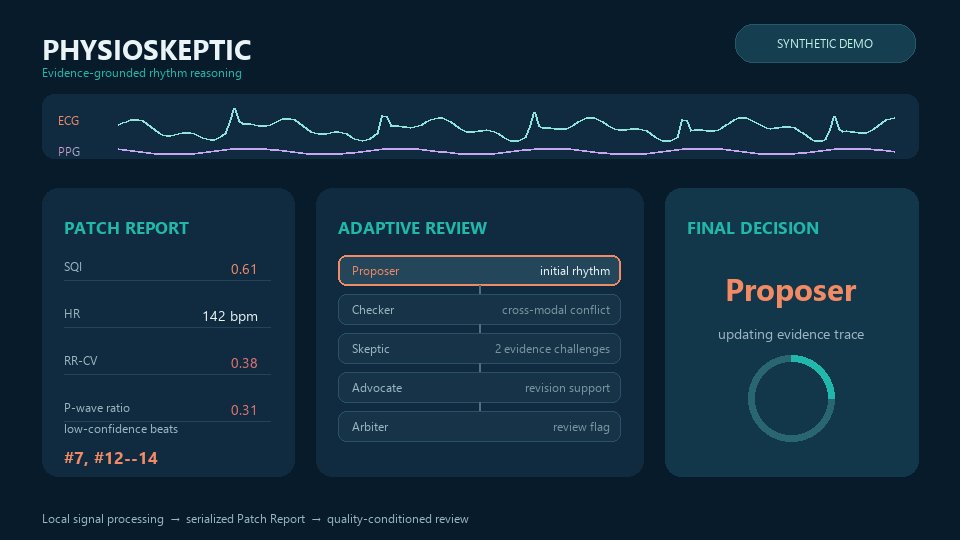
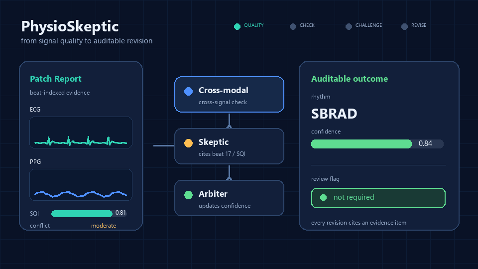
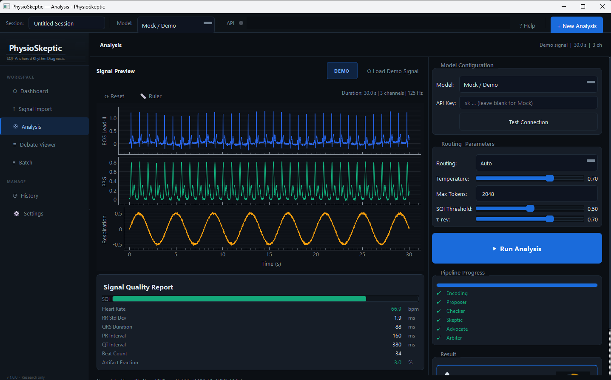

<p align="center">
  
</p>

<h3 align="center">Interpreting multimodal physiological signals through sceptical reasoning with language model agents</h3>

<p align="center">
  <a href="https://github.com/liuyisi123/PhysioSkeptic/actions/workflows/tests.yml"></a>
  <a href="pyproject.toml"></a>
  <a href="LICENSE"></a>
</p>

<p align="center">
  <a href="#overview">Overview</a> ·
  <a href="#quick-start">Quick start</a> ·
  <a href="#demonstrations">Demos</a> ·
  <a href="#using-the-code">Usage</a> ·
  <a href="docs/reproducibility.md">Reproducibility</a> ·
  <a href="#documentation">Documentation</a>
</p>

## Overview

PhysioSkeptic investigates how language model agents can examine physiological
interpretations through the measurements that support them. Its central
interface is the **Patch Report**: numerical observations retain their event
indices, source intervals and signal-quality information, so a disputed finding
can be related to a particular part of a recording.

The code combines physiological signal processing with quality-dependent review
by Proposer, Checker, Skeptic, Advocate and Arbiter roles. ECG and PPG provide the
current rhythm-analysis setting. The role sequence depends on measurement
quality, initial confidence and cross-modal conflict, rather than applying the
same amount of deliberation to every recording.

| Component | What to explore | Entry point |
| --- | --- | --- |
| Physiological measurements | Landmark detection, interval features and report construction | [Signal processing](src/physioskeptic/signal_processing.py) · [Patch Report](src/physioskeptic/patch_report.py) |
| Signal representation | Temporal and frequency pathways with quality-weighted fusion | [PhysioPatch encoder](src/physioskeptic/encoder.py) |
| Adaptive review | Fast, Standard and Deep routes with targeted challenges | [Routing](src/physioskeptic/routing.py) · [Agent workflow](src/physioskeptic/debate.py) |
| Role instructions | Structured inputs and outputs for the five roles | [Prompt templates](prompts/) · [Configuration](configs/default.yaml) |

The public examples run locally with synthetic signals and a deterministic
mock backend. For the relationship between this implementation and the study
analyses, see [reproducibility](docs/reproducibility.md).

## Quick start

Requires **Python 3.10+**. A GPU and API key are not needed for the demo.
Install from the repository root; the demo loads its prompt files from this
checkout.

```bash
git clone https://github.com/liuyisi123/PhysioSkeptic.git
cd PhysioSkeptic
python -m venv .venv
```

<details>
<summary>Activate the environment</summary>

**Linux / macOS**

```bash
source .venv/bin/activate
```

**Windows PowerShell**

```powershell
.venv\Scripts\Activate.ps1
```

</details>

```bash
python -m pip install --upgrade pip
python -m pip install -e ".[dev]"
python scripts/run_demo.py
```

The demo generates a 30-second synthetic ECG–PPG recording and prints a JSON
object containing `patch_report`, `route`, `transcript` and `final`. The final
output includes `rhythm`, `confidence` and `review_recommended`. These are mock
responses for exploring the workflow, not benchmark predictions.

## Demonstrations

<table>
  <tr>
    <th align="left">Review allocation</th>
    <th align="left">Observation and interpretation</th>
  </tr>
  <tr>
    <td width="50%"></td>
    <td width="50%"></td>
  </tr>
  <tr>
    <td>Explore how quality, confidence and conflict change the review route.</td>
    <td>Follow a report observation through challenge, response and final interpretation.</td>
  </tr>
</table>

Both animations use synthetic examples. Open [demo/index.html](demo/index.html)
locally for an interactive browser demonstration, with no server or installation.
The browser view illustrates routing and role interactions; it does not execute
the encoder or call a language model.

## Using the code

### Review a Patch Report

```python
import json
from pathlib import Path

from physioskeptic import MockLLMClient, PhysioSkepticDebate

report = json.loads(Path("data/sample_patch_report.json").read_text())
engine = PhysioSkepticDebate(MockLLMClient(), Path("prompts"))
result = engine.run(report)

print(result.route.value)
print(result.final)
```

The [example report](data/sample_patch_report.json) is synthetic. Its fields are
defined in the [JSON schema](data/patch_report.schema.json). For batch processing,
input/output formats and backend integration, see the [usage guide](docs/usage.md).

### Test the implementation

```bash
python -m pytest -q
python scripts/check_docs.py
```

The unit tests cover Patch Report construction and schema validation, route
thresholds and challenge allocation. The documentation check verifies local
links and section anchors.

### Explore the desktop interface

The optional PySide6 interface provides signal views, Patch Reports and agent
transcripts. It is separate from the Python research package.

```bash
python -m pip install -r physioskeptic_ui/requirements.txt
python physioskeptic_ui/main.py
```

<details>
<summary>View the interface</summary>

<p align="center">
  
</p>

</details>

## Data and study analyses

The study uses MIMIC-III-Ext-PPG and separate MC-MED analyses. Obtain source data
under the respective providers' access and licence conditions; the repository
contains a synthetic report rather than source waveforms.

- [MIMIC-III-Ext-PPG, version 1.0.0](https://doi.org/10.13026/nmwb-6h34)
- [MC-MED dataset publication](https://doi.org/10.1038/s41597-025-05419-5)

The [reproducibility guide](docs/reproducibility.md) describes the runnable
examples, training entry points and study-specific resources needed for an
experimental run. Dataset access is separate from the MIT licence on this code.

## Documentation

| Resource | Contents |
| --- | --- |
| [Usage](docs/usage.md) | Python example, JSONL batches and backend interface |
| [Reproducibility](docs/reproducibility.md) | Software coverage, configuration and experiment resources |
| [Data](data/README.md) | Report schema, synthetic example and source datasets |
| [Browser demo](demo/README.md) | Interactive routing demonstration |
| [Contributing](CONTRIBUTING.md) | Reporting issues, testing and proposing changes |

<details>
<summary>Repository layout</summary>

```text
src/physioskeptic/   Signal processing, encoder, reports and agent review
prompts/            Five role templates with structured output definitions
configs/            Reference configuration
data/               JSON schema and synthetic report
scripts/            Demo, batch evaluation and documentation checks
tests/              Unit tests
demo/               Browser demonstration
docs/               Usage and reproducibility guides
physioskeptic_ui/   Optional desktop interface
```

</details>

For software questions, [open an issue](https://github.com/liuyisi123/PhysioSkeptic/issues).
